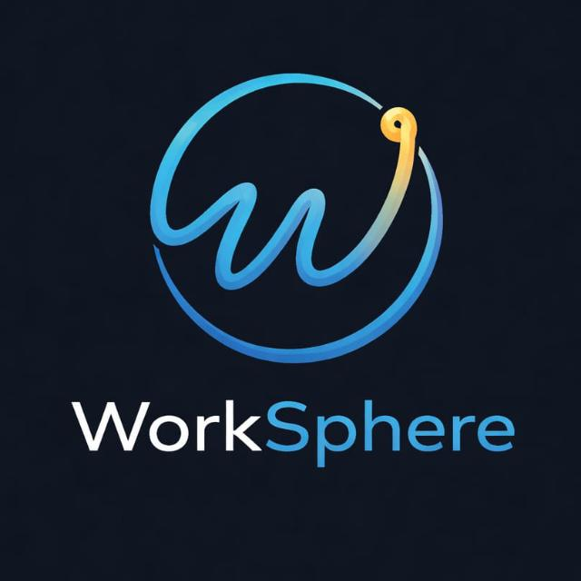

# WorkSphere.design — Digital & Visual Atelier Platform



> **Visual Architecture & Living Prototypes**  
> A bespoke hybrid design platform engineered to showcase static graphic craft (Photoshop, Illustrator, CorelDraw) and living interactive systems (Figma, Lunacy, Motion) with **strict 1:1 aspect-ratio fidelity** and zero cropping.

---

## ✦ Key Platform Features

1. **Strict Aspect-Ratio Guarantee (Zero Distortion / Zero Cropping):**
   - True fluid masonry columns where cards naturally adapt to the exact height and width of any poster, packaging die-line, or widescreen mockup.
   - Built for 4:5 vertical posters, 3:2 print, 1:1 squares, 9:16 mobile UI reels, and 16:9 widescreen.

2. **Interactive "Before & After" Craft Inspection Slider:**
   - Layer peeler allowing visitors to drag between raw wireframe / unretouched dieline and final graded studio artwork.

3. **Color Palette & Token Inspector:**
   - 1-click click-to-copy HEX codes and studio design token palettes for every project.

4. **Interactive Studio Scope & Cost Estimator:**
   - Real-time atelier calculator allowing potential clients to select disciplines, configure sprints, and generate tailored commission briefs.

5. **Theme Switching Engine:**
   - Instant toggle between **Dark Luxury & Avant-Garde** (`#07080B`) and **Light Studio Editorial** (`#F8F9FC`) with zero theme flash.

6. **Studio Admin Back-Office (Client-Side CMS):**
   - Direct drag-and-drop upload with **automatic aspect ratio calculation** from native image/video dimensions.
   - Live interactive Figma/Lunacy iframe embed runner.
   - Full JSON Export & Restore for portable database backups.

---

## 🛠️ Toolchain Matrix

- **Adobe Photoshop:** Photo manipulation, chromatic grading, and editorial posters.
- **Adobe Illustrator:** Precision vector geometry, brand identities, and isometric key visuals.
- **CorelDraw:** Packaging die-lines, foil stamping, and CMYK offset print separations.
- **Figma:** Interactive auto-layout design systems, variables, and clickable prototypes.
- **Lunacy:** Multi-platform vector design tokens and rapid UI wireframes.

---

## 🚀 Quick Start

### Development
```bash
# Install dependencies
npm install

# Start Vite dev server
npm run dev
```

### Production Build
```bash
# Compile and sync production assets
npm run build
```

### Preview With VS Code Live Server
Open `index.html` directly in VS Code and select **"Open with Live Server"**. Pre-bundled assets in `assets/` run without any Node dependencies required.

---

## 🌐 Deploy to Vercel or Cloudflare Pages

1. Import this repository into [Vercel](https://vercel.com) or [Cloudflare Pages](https://pages.cloudflare.com).
2. Framework Preset: **Vite**
3. Build Command: `npm run build`
4. Output Directory: `dist`
5. Connect your custom domain: `worksphere.design`

---

© 2024 WorkSphere.design. All rights reserved.

